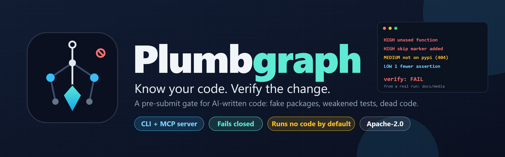
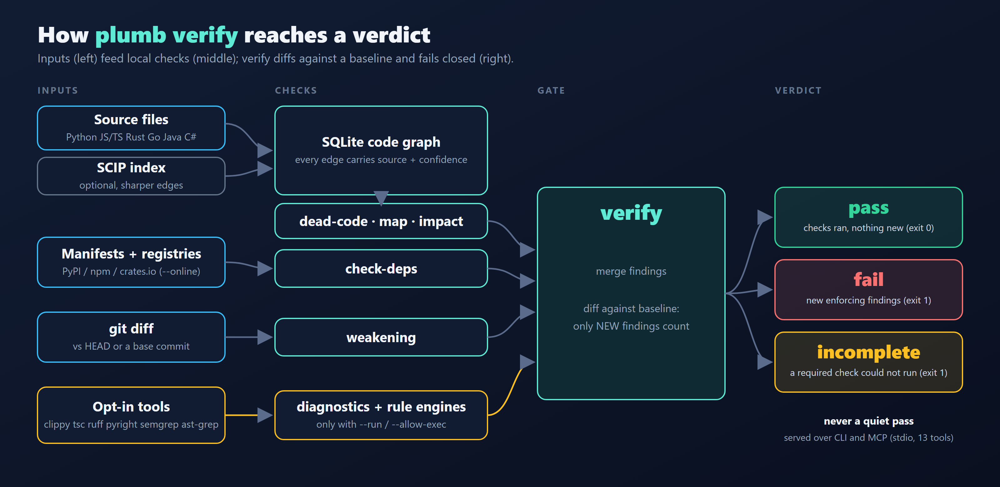
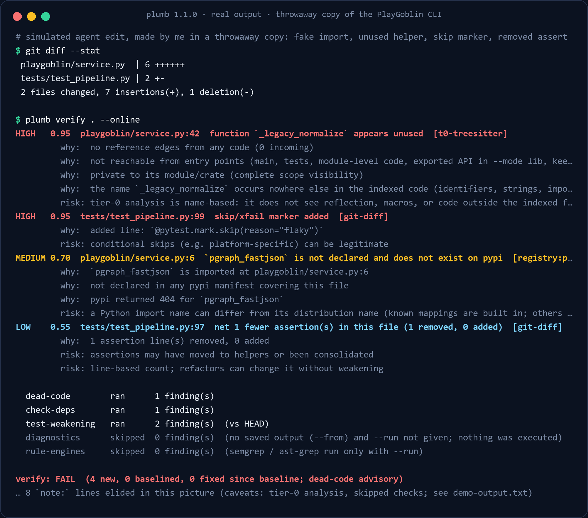
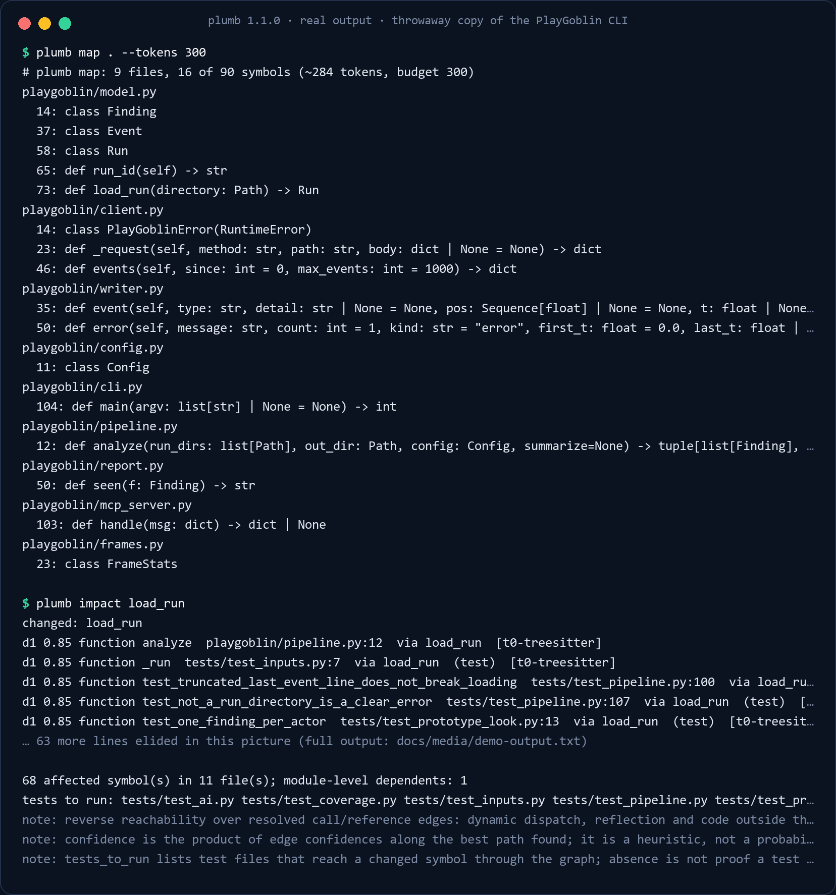
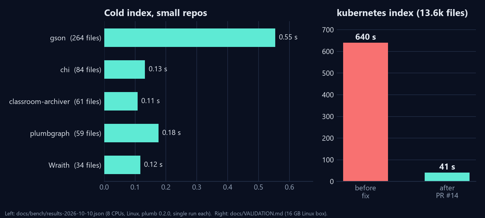

> ⭐ **GitHub: [github.com/grloper/plumbgraph](https://github.com/grloper/plumbgraph)** · open source (Apache-2.0) · by [@grloper](https://github.com/grloper)





AI coding agents write code quickly and verify it badly. After a few months of watching them work on my own projects, the same three failures kept turning up, and none of them are caught by "the tests pass". So I built a small open-source tool, Plumbgraph, that checks them on the diff before the agent is allowed to say it is done.


*Real output of `plumb 1.1.0` (built from the v1.1.0 tag) on a throwaway copy of the Python CLI of my other project, PlayGoblin: 35 Python files. The clean copy passes. Then I made an edit by hand that imitates an agent (a fake import, an unused helper, a skip marker, a deleted assertion) and `plumb verify` fails. The edit is simulated by me; the output is not. The GIF is a replay of captured text, and long lines are cut in the picture; the verbatim output is in [`docs/media/demo-output.txt`](https://github.com/grloper/plumbgraph/blob/main/docs/media/demo-output.txt).*

### The three failures

**Packages that do not exist.** The agent imports something plausible and the install fails, or worse, someone registers the name later. A USENIX Security 2025 study cited in the repo's `docs/STRATEGY.md` reported that 19.7% of package recommendations from 16 models were hallucinated; I have not reproduced that number, I just find it reason enough to check.

**Tests that got weaker.** Deleted tests, new skips, loosened assertions. The suite is green because the suite shrank. A diff-level check catches this subset of test tampering (not every kind, for example special-casing inputs).

**Code nothing calls.** Agents add helpers and forget them.

### What Plumbgraph does

`plumb` indexes your repo with tree-sitter into a local SQLite file (Python, JS/TS, Rust, Go, Java, C#). It executes none of your code by default. Every result carries a `source` and a `confidence`, so an agent (or you) can tell a guess from compiler-grade evidence.



- `check-deps`: imports vs your manifests, and with `--online`, against PyPI, npm and crates.io. Registry errors are never reported as "does not exist".
- `weakening`: reads `git diff` for deleted tests, new skips and loosened assertions. On seeded commits it flagged 12/12 on Python, JS, Rust, Go and C# with 0 of 3 benign changes flagged per repo. I seeded those myself, so read that as a regression check, not a benchmark.
- `dead-code`: reachability from entry points and tests, with evidence and false-positive risks per finding.
- `map` and `impact`: a PageRank-ranked overview under a hard token budget, and transitive callers plus the tests to run.
- `verify`: merges all of it (plus diagnostics, semgrep and ast-grep with `--run`), diffs against a baseline so only new findings count, and returns one verdict.



The four findings above are what the tool printed for my simulated edit, each with a `why:` and a `risk:` line. The `risk:` lines matter: the skip marker could be a legitimate platform skip, and a Python import name can differ from its package name. The tool says so instead of pretending to be sure.

`map` and `impact` are the other half, the part an agent uses before it edits. On the same copy, `plumb impact load_run` lists 68 affected symbols across 11 files and the six test files to run, each edge with a confidence that drops with distance:



### A gate that fails closed

The verdict is the part I spent the most time on. `pass` means the selected checks completed and nothing new met its threshold. `fail` means new enforcing findings. `incomplete` means a required check failed, timed out or could not run, or the Git base is missing; it never passes. Dead code is advisory by default because an index cannot prove an external caller, reflection or safe deletion. It is a gate over the checks you selected, not proof the change is correct. In the clean run of the demo, two optional checks were skipped, and the output says so rather than counting them as passed.

For MCP, an `isError: false` response is not a pass: you must check `data.verdict == "pass"`. And the agent cannot grant itself powers: running external tools needs `--allow-exec` and writing baselines needs `--allow-baseline-update`, both set by the operator when the server starts. Results are marked `untrusted: true`, because text from repository files is data, never instructions.

### Quickstart

```bash
git clone https://github.com/grloper/plumbgraph && cd plumbgraph
git checkout v1.1.0
cargo install --path crates/cli --locked      # Rust 1.85+; installs `plumb`

plumb map . --tokens 1500
plumb check-deps . --online                   # sends package names only
plumb verify .                                # needs a Git base
claude mcp add plumbgraph -- plumb mcp --root /path/to/project
```

`plumb init --dry-run` previews the AGENTS.md block and MCP config it would write. The AGENTS.md block is deliberately minimal: a study cited in the docs found verbose context files can reduce agent success and raise cost.

For this article I built it again on a Windows machine with the GNU toolchain. It needed a MinGW `gcc` on `PATH` (the `ring` crate failed to compile without it), and it then built in about a minute.

### What real repos taught me

I ran it on requests, express, ripgrep, cobra, gson, Newtonsoft.Json, kubernetes and VS Code. The first version took 640 s to index kubernetes and ran out of memory on later commands; after fixes (PR #14: edge dedup, an ambiguity cap, a resolver fix), the index takes 41 s and commands finish in 6-13 s on a 16 GB Linux box. Running it on one of my own Unity projects exposed false positives (Unity message methods on partial classes), which are fixed in v1.0.3. Using v1.0.0 on Windows showed that every provider was reported missing because lookup ignored `.exe` and `.cmd`. None of that shows up on toy fixtures.



*Left: `docs/bench/results-2026-10-10.json`, measured by `scripts/bench.py` with an older build (plumb 0.2.0) on an 8-CPU Linux machine, one run per repo. Right: `docs/VALIDATION.md`. These are not comparisons with other tools, and I have not measured any other tool.*

### Honest limits

- Without a SCIP index the analysis is name-based: no types, and common names give lower-confidence edges.
- Dead-code precision on libraries in the default app mode is low (use `--lib`). A hand review of 76 findings on chi and gson found 1 real unused function. Recall is unmeasured on real code.
- Reflection, `eval`, DI containers and macros are invisible.
- MCP: stdio only. I tested with the official TypeScript SDK, the inspector CLI and one agent host on Windows. I have not tested Claude Code, Cursor or Codex end to end.
- Windows was exercised by hand on one machine and CI is Linux only. There are no prebuilt binaries and no crates.io package.
- I have not run an experiment showing that the tool improves agent outcomes on real tasks. I make no claim about that.
- The demo edit above is a hand-made imitation of an agent, on a small repo. It shows what the checks print, not how often real agents make these mistakes.

### Try it, and help

Run `plumb verify .` on a branch an agent wrote and tell me what it got wrong: false positives, false negatives, and anything that breaks in Claude Code, Cursor or Codex. Issue templates for bugs and false positives are in the repo: [github.com/grloper/plumbgraph](https://github.com/grloper/plumbgraph). Packaging (prebuilt binaries, crates.io) and more SCIP indexers are the obvious contributions.
